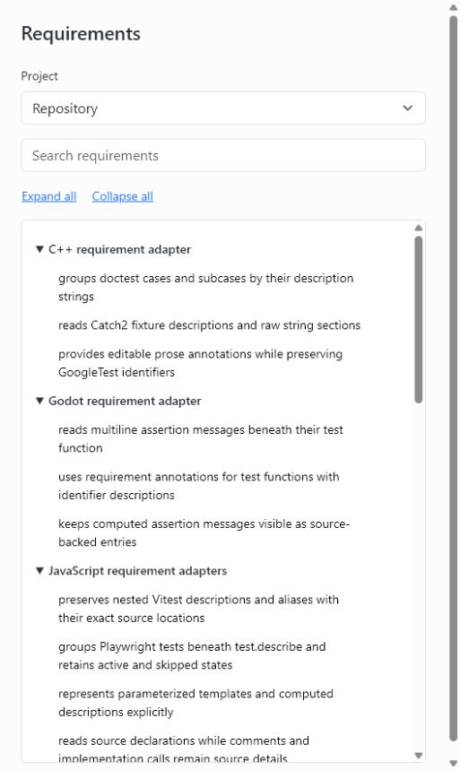

# Requirements overview

Local requirement editor built with TypeScript, Vite, and Bootstrap.



Select a project to view its complete requirement outline. Headings use the `describe` text, and nested `describe` blocks preserve their hierarchy. Click a test description to edit it in place. **Enter** saves the description text in the test file; **Esc** cancels. Search refines the selected project. Hover over a test or focus its row to reveal the icon on the right, then open its source line in VS Code.

Test source edits, additions, removals, and project configuration changes update the view automatically. A debounced file watcher refreshes the shared catalog and publishes notifications through a reconnecting event stream. The tree reuses its nodes to retain scroll position, expanded suites, and active drafts. Source-version checks preserve external edits when a draft becomes stale.

## Start

Install Node.js 24 and pnpm 12.3.4, then install the dependencies in this checkout:

```sh
pnpm install
```

Start the app from the directory whose tests you want to browse. Discovery uses the current working directory (CWD):

```sh
cd /path/to/your/project
node /path/to/requirements-overview/cli.ts
```

For a checkout at `~/requirements-overview`, PowerShell users can run:

```powershell
Set-Location C:\path\to\your\project
node "$HOME/requirements-overview/cli.ts"
```

Open [the local app](http://127.0.0.1:3110/). Run `pnpm dev` inside this checkout to browse its own tests. The server serves the app from its installed location and reads requirement sources from the starting directory.

## Architecture

The tree collects source descriptions through the `TestFrameworkAdapter` interface. `PlaywrightAdapter`, `VitestAdapter`, `GodotAdapter`, and `CppAdapter` translate their testing systems into a shared requirement model. Jest and Node adapters cover the repository's additional JavaScript tests. The JavaScript adapters share an AST reader through composition.

Vitest and Playwright entries use nested `describe` titles and `it` or `test` titles. Parameterized declarations appear once with their template description. Computed descriptions appear as source-backed entries and support editing through their source files. The overview describes collected test declarations.

Godot entries use assertion messages and test function descriptions. A test function with helper assertions can have a `## Requirement: ...` annotation. C++ supports doctest and Catch2 `TEST_CASE`, fixture cases, `SCENARIO`, `SUBCASE`, and `SECTION`, plus GoogleTest `TEST`, `TEST_F`, `TEST_P`, and `TYPED_TEST`. GoogleTest prose belongs in a `// Requirement: ...` annotation, preserving the test identifiers.

Revise a requirement description and press **Enter**. Saving replaces the source description or requirement annotation and refreshes the catalog. Test implementation and application code stay as they are. Description editing works independently of test-runner configuration.

## Discovery and validation configuration

Discovery scans the starting directory recursively. Dependency folders, generated output, and hidden directories are excluded. The nearest `package.json` or `project.godot` groups each test into a project; tests belonging to the starting directory appear under `Repository`.

Optional `requirements-overview.config.json` in the starting directory selects discovery roots and supplies validation metadata in catalog responses. Roots belong inside that directory. Validation recipes match path prefixes, with the most specific prefix taking precedence. Commands use argument arrays with their declared repository-relative `cwd`, or the recipe's `path` directory. Description saves use the source range and version checks.

```json
{
  "roots": ["src", "tests"],
  "validation": [
    {
      "path": "tests/native",
      "commands": [
        { "command": "cmake", "arguments": ["--build", "build"], "cwd": "tests/native" },
        { "command": "ctest", "arguments": ["--test-dir", "build", "--output-on-failure"], "cwd": "tests/native" }
      ]
    }
  ]
}
```

The catalog includes configured C++ build and test recipes, Godot runner metadata, and JavaScript runner metadata from the owning project. These commands belong to catalog metadata; the requirement editor performs source-text updates.

## Development

Run `pnpm test`, `pnpm typecheck`, and `pnpm build` from this checkout. Unit tests use Vitest and exercise the adapters, catalog, live updates, and description saves through their public APIs.

Framework support belongs in adapters that implement `TestFrameworkAdapter`. The catalog, source editor, and UI use the shared requirement model.

## License

[MIT-0](LICENSE).
